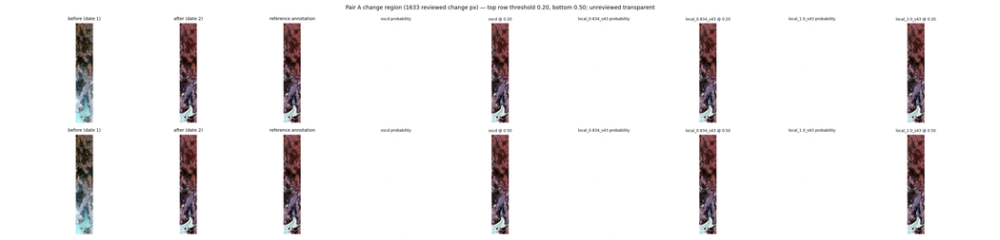
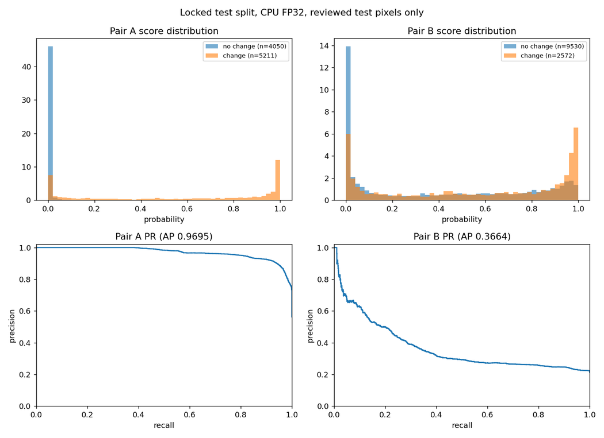
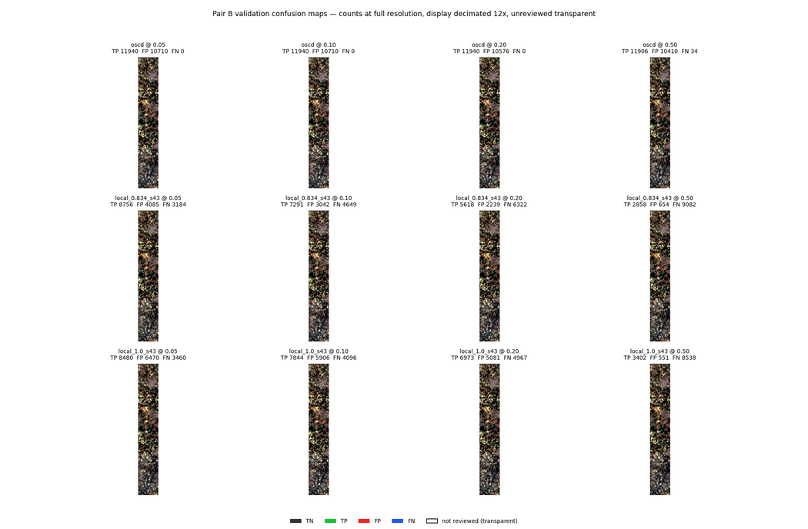
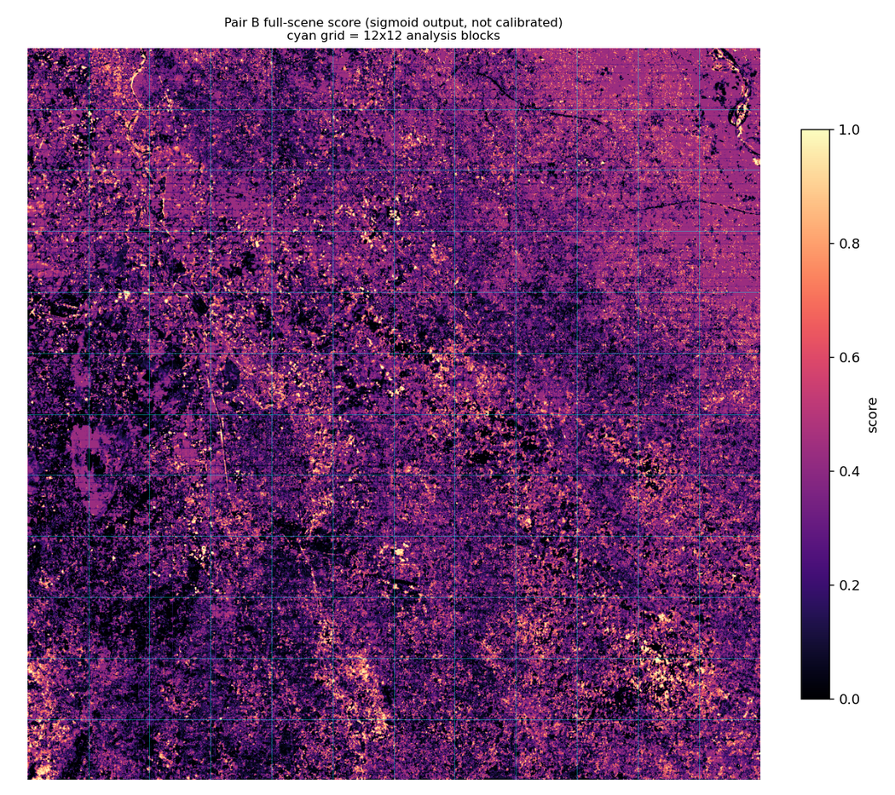
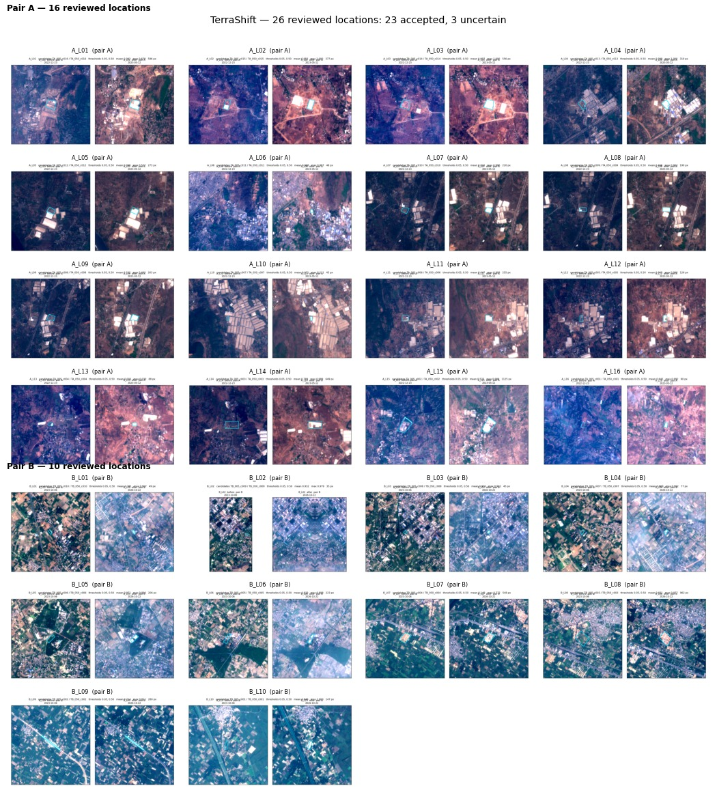
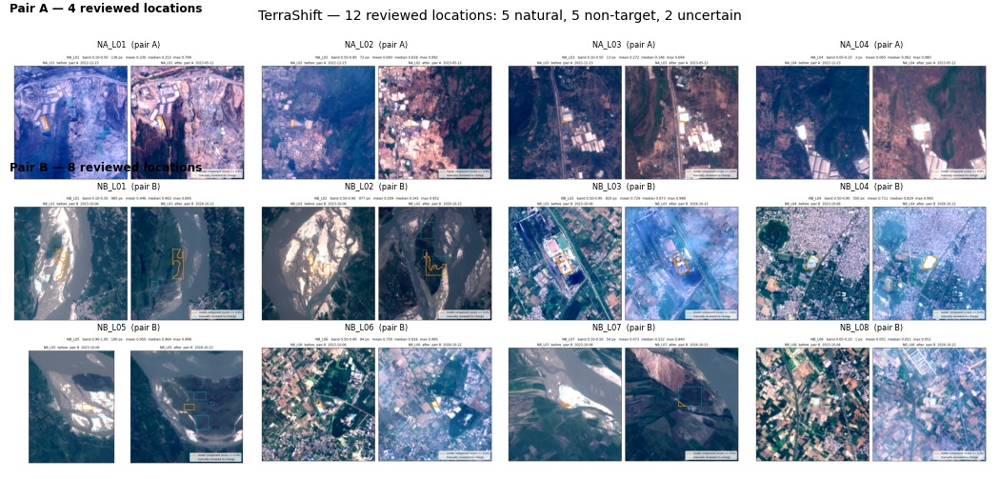

# TerraShift — Man-Made Change Detection Technical Report

**Status:** final, with two document parts that must be read as different evidence.

* Part I (Sections 1–9) covers the **method, the historical OSCD development work and the pipeline
  decisions**: measurements made on the original OSCD benchmark before the local model
  existed, together with the preprocessing, registration and validity decisions that apply to
  both models. It is not exclusively OSCD material — several sections report local
  measurements of the local products, for example the mask statistics in Section 2.1, the
  registration residuals in Section 2.2 and Section 5.7, and the candidate-volume diagnostics. Where a
  section mixes the two, the local measurement is identified as such.
* Part II (Sections 10–20) reports the **local SkyServe results**: the fine-tuned model, the locked
  test evaluation, the quantisation comparison, the human reviews and the consolidated register.

**Supporting documents.** Some sections cite internal project notes under `docs/`. Those notes
belong to the internal archive and are not included in the submitted repository; they are named
for provenance only, and a public reader is not expected to open them. The documents that ship
are listed in the repository README.

Where Part I states something as pending or absent, Section 9 records which of those statements Part II
supersedes. Part II is authoritative.

**Data:** four Sentinel-2A MSI Level-1C products, two bi-temporal pairs.

| Pair | Tile | Date 1 | Date 2 | Gap | Processing baseline |
|---|---|---|---|---|---|
| A | T43QBB | 2022-12-23 | 2023-05-12 | 4.7 months | 05.10 both dates |
| B | T43RGM | 2023-10-06 | 2026-10-22 | 3.0 years | 05.10 and 05.13 |

Pair A and Pair B are different tiles with different acquisition geometry. They
are not one site observed four times, and no time-series claim is made across
them.

---

## 1. Data requirements and execution plan

**Status: measured.**

- 24-region original OSCD audited: 14 official train regions, 10 official test
  regions, 624 native and 624 rectified band files, labels on the 1 = no change
  / 2 = change encoding in all 24 regions while the dataset README documents
  0/1. The loader accepts both and rejects anything else.
  Evidence: `outputs/audit/oscd_original_data_audit.json`, `docs/oscd_data.md`.
- OSCD100 was demoted to a pipeline smoke test: all 100 crops carry the same
  two acquisition dates, have no CRS, and its 60/20/20 split is a random crop
  split of one pair. No benchmark number is taken from it.
- The plan, the phase breakdown and the decision log are in `PLAN.md`.

**Not claimed:** that the OSCD label distribution resembles these two tiles.

## 2. Preprocessing and registration

**Status: measured for registration, validity and normalisation.**

### 2.1 Observation validity

Each date gets a validity mask from source NoData, `MSK_CLASSI` (opaque cloud,
cirrus, snow/ice) and `MSK_QUALIT` (lost, degraded, defective, pixel nodata,
partially corrected, saturated) for every band in the four-band contract. The
two dates and the registration coverage combine into one paired mask.

Measured on the four products at 20 m, 5490 x 5490:

| Pair | Date 1 invalid | Date 2 invalid | Paired valid |
|---|---|---|---|
| A | 17 px | 2,394 px (2,331 cirrus) | 30,137,689 / 30,140,100 (99.99 %) |
| B | 29 px | 30 px | 30,140,041 / 30,140,100 (100.00 %) |

These products are **not** cloud-free, but their cloud mask is empty, so the mask
removes very little. `MSK_CLASSI` contains no flagged pixel in any of the four
products except 259 cirrus pixels on Pair A's second date, and the product
metadata reports `<Cloud_Coverage_Assessment>` of 0.0 on every date. The paired
mask is therefore a detector-integrity screen, not a cloud screen, and the name
"observation validity" is accurate only in that narrow sense.

Pair B's second date does carry a visible atmospheric difference: haze, not
cloud. Measured on the 20 m grid, the after date is brighter in blue by a median
of 0.0180 (87.2 % of pixels), brighter in red by 0.0080, and darker in NIR by
0.0278 — scattering, with 24.0 % of the tile above a blue shift of 0.03. Thick
cloud is negligible (0.002 % of the grid). No product mask records the haze.
Details and the diagnostic layer are in `docs/pair_b_validity_audit.md`.

The mask still matters: it changes the reference-band spread, and therefore every
change score, because a handful of saturated pixels had been inflating the
standard deviation.

### 2.2 Registration

One global translation per pair, estimated with masked ECC on band B08 over
five 2000 x 2000 land windows.

| Pair | Median shift | Correlation (median / min) | Windows converged | Residual RMSE mean (normalised units) |
|---|---|---|---|---|
| A | -0.122 / -0.639 px  (-1.22 / -6.39 m) | 0.832 / 0.581 | 4 of 5 | 0.6523 |
| B | +0.013 / -0.119 px  (0.13 / -1.19 m) | 0.508 / 0.219 | 5 of 5 | 1.0120 |

The fifth Pair A window is open water: land fraction 0.0 %, B08 standard
deviation 0.0023 against 0.045-0.073 in the four that converged. ECC hit its
iteration cap on a textureless region, so the median uses the four converged
windows.

The RMSE is computed on zero-mean, unit-standard-deviation normalised B08
(`registration._normalise`), so it is expressed in standard deviations of the valid
population, not in reflectance. Per-window bounds, correlations and residual
displacements, and the difference between the masked and unmasked pass, are tabulated in
`docs/measurement_uncertainty.md` section 5.2a.

**Limitation.** Every residual quoted here is measured on the estimation windows
themselves, after the estimated translation is applied. No artefact retained in this
repository records an independent control-window measurement, so the report does not
claim independent control-window validation of registration accuracy. The residual
figures show agreement on the windows that were aligned; they are not a test of
agreement on windows the estimator never saw.

### 2.3 Normalisation

Four methods compared at 100 m on stable land, fitted on a fit half and
evaluated on a disjoint half. Mean absolute reflectance difference, before to
after:

| Pair | none | global | pif | histogram |
|---|---|---|---|---|
| A | 0.014841 → 0.014841 (0.0 %) | 0.014841 → 0.008960 (39.6 %) | 0.014841 → 0.009755 (34.3 %) | 0.014841 → 0.009418 (36.5 %) |
| B | 0.012051 → 0.012051 (0.0 %) | 0.012051 → 0.008192 (32.0 %) | 0.012051 → 0.008766 (27.3 %) | 0.012051 → 0.008255 (31.5 %) |

Evidence: `outputs/audit/normalization_v2_observation_valid/`.

Stable-land error alone would select a global fit. That is not sufficient: a
correction can lower the error on stable ground by shrinking real change. A
second experiment therefore measures preservation directly.

**Positive controls.** The original OSCD labels mark new buildings and roads.
They are human annotations made by the dataset authors, independent of this
project's scores. The 13 development regions were scored before and after each
correction; the 10 official test regions and `mumbai` were never read. Metrics:
AUROC of the change score against the labels, and preservation, the mean score
on labelled-change pixels after the correction divided by the same mean before.

| Method | Median delta AUROC | Median preservation | Worst preservation | Median stable MAE reduction |
|---|---|---|---|---|
| none | 0.0000 | 1.000 | 1.000 | 0.0 % |
| global | +0.0344 | 0.947 | 0.837 | 19.8 % |
| histogram | +0.0294 | 0.988 | 0.887 | 16.2 % |

Both corrections improve separability in 12 of 13 regions, so neither destroys
the change signal. They differ in what they cost. A global fit ranks slightly
better and reduces stable-land error more, but attenuates the labelled change
amplitude more: 5.3 % at the median, 16.3 % in the worst region (pisa).
Histogram matching attenuates 1.2 % at the median and 11.3 % in the worst case.

**Recommendation: keep histogram matching.** The ranking difference is small
(+0.005 median AUROC) and the preservation difference is systematic: histogram
preserved the change amplitude better in all 13 regions. For a task whose
output is the location of structural change, attenuating the signal is the
worse failure mode.

Evidence: `outputs/audit/normalization_positive_controls_v1/`.

Caveat: the controls are OSCD tiles and dates, not Pair A or Pair B, and they
were scored in raw digital numbers because the rectified arrays carry no
product metadata. The score divides by each band's standard deviation, so the
comparison is unit-free, but it is a cross-domain result. Local positive
controls become possible once the manual labels exist and must replace this
evidence in the final report.

**Not claimed:** that either method preserves genuine construction on Pair A or
Pair B. That needs reviewed local labels.

## 3. Architecture for onboard and ground execution

**Status: design. No performance numbers are asserted.**

The ground segment is implemented: SAFE reader, quality and validity masks,
masked registration, normalisation, four-band stack, Siamese U-Net, sliding
window inference, georeferenced output. The spacecraft segment is designed but
not implemented; it exists to route tiles, not to confirm change.

Full diagram, interface contract and the measured/proposed distinction: Section 16.

**Pending:** target-board benchmark, onboard throughput and power. INT8 quantisation is no longer
pending — it was implemented and evaluated on held-out data (Section 14), and is **not recommended for
deployment**. No onboard estimate is stated here because none has been measured.

## 4. Training and hyperparameter tuning

**Status: measured on the original OSCD development split.** These are
development results. They are not SkyServe results, and they do not come from
the final local model.

### 4.1 Configuration and GPU memory

Hardware: RTX 3050 Ti Laptop, 4.00 GiB VRAM, i7-12650H, WSL2. PyTorch
2.11.0+cu128, AMP enabled.

Memory measured on the real model, the real loss and the real training step,
at 128 x 128:

| Batch | Peak allocated GiB | Peak reserved GiB | Free after GiB | s/step |
|---|---|---|---|---|
| 2 | 0.040 | 0.059 | 3.941 | 0.05 |
| 4 | 0.077 | 0.096 | 3.904 | 0.04 |
| 8 | 0.151 | 0.164 | 3.836 | 0.05 |
| 16 | 0.300 | 0.332 | 3.668 | 0.07 |

At 128 x 128 the model is small: batch 16 leaves 3.67 GiB free. Memory is not
the constraint, so batch size was chosen for optimizer steps per epoch instead.
Batch 8 gives 50 steps over 399 training windows; batch 16 gives 25 and was
measured as a separate trial (section 4.4), where it did not help.

| Item | Value |
|---|---|
| Training regions | 11: aguasclaras, bercy, nantes, paris, rennes, saclay_e, abudhabi, cupertino, beihai, hongkong, beirut |
| Validation regions | bordeaux (20 windows), pisa (42 windows) |
| Test regions | the 10 official OSCD test regions, opened once after selection |
| Windows | 399 train, 62 validation, 230 test, all 128 x 128 |
| Patch / batch | 128 / 8 |
| Epochs | 20 |
| Optimiser | AdamW, lr 1e-4, weight decay 1e-4 |
| Precision | AMP: autocast plus GradScaler |
| Loss | masked BCE-with-logits plus soft Dice |
| pos_weight | 40.81, from the 2.39 % training change fraction |
| Seed | 42, repeated for 43 and 44 |

Gradient accumulation is not implemented. No code path mentions it and no
setting enables it.

### 4.2 Baseline run, seed 42

20 epochs, 114.2 s training and 15.9 s validation, 5.7 s per training epoch.

| Epoch | Train loss | Val loss | Val AP | GPU % | Peak reserved GiB |
|---|---|---|---|---|---|
| 1 | 2.400 | 1.986 | 0.076 | 13 | 0.170 |
| 5 | 1.739 | 2.023 | 0.155 | 17 | 0.170 |
| 10 | 1.617 | 1.761 | 0.290 | 17 | 0.170 |
| 15 | 1.528 | 1.722 | 0.231 | 18 | 0.170 |
| 18 | 1.511 | 1.590 | **0.336** | 17 | 0.170 |
| 20 | 1.479 | 1.604 | 0.321 | 15 | 0.170 |

Best checkpoint: epoch 18, validation AP 0.3362, AUC 0.9025, F1 0.1765,
IoU 0.0968. Selected by validation AP, as specified.

GPU utilisation averaged 15.9 % with a 34 % maximum. The run is data-bound:
128 x 128 patches with `num_workers: 0` cannot feed the GPU faster than this
model consumes it. Peak reserved memory never exceeded 0.170 GiB.

Per-region validation at the selected epoch:

| Region | Windows | AP | AUC | F1 |
|---|---|---|---|---|
| bordeaux | 20 | 0.1898 | 0.9349 | 0.1358 |
| pisa | 42 | 0.4478 | 0.8907 | 0.1953 |

### 4.3 Three-seed repeat

Standard deviations are labelled, because the two conventions differ by a
factor of 1.22 at n = 3.

| Seed | AP | AUC | F1 | IoU |
|---|---|---|---|---|
| 42 | 0.3362 | 0.9025 | 0.1765 | 0.0968 |
| 43 | 0.2671 | 0.8885 | 0.1471 | 0.0794 |
| 44 | 0.2585 | 0.8823 | 0.1298 | 0.0694 |
| mean | 0.2873 | 0.8911 | 0.1511 | 0.0819 |
| sample sd (ddof=1) | 0.0426 | 0.0103 | 0.0236 | 0.0139 |
| population sd (ddof=0) | 0.0348 | 0.0084 | 0.0193 | 0.0113 |

Seed 42 sits **1.15 sample standard deviations** above the three-seed mean
(1.41 population standard deviations). An earlier version of this report said
2.7; that figure was wrong and is withdrawn. Seed 42 is still the best of the
three, but it is the upper end of a normal spread, not an outlier.

`multi_seed_summary.csv` writes the population standard deviation under the row
label `std_population`; the trainers label it that way since this correction.
Files written before the change carry the label `std` with the same meaning,
`np.nanstd`, ddof = 0. For seeds 43 and 44 the reported 0.0043 is the population
standard deviation over two values; the sample equivalent is 0.0061.

A single-seed AP of 0.336 would still have overstated the model, because the
spread across seeds is larger than the difference between the best and worst
hyperparameter trial.

### 4.4 Controlled trials

One variable changed per trial, batch 8 and seed 42 unless stated. Nothing was
run concurrently on the 4 GiB GPU.

| Trial | Change | AP | AUC | F1 | IoU |
|---|---|---|---|---|---|
| baseline | - | 0.3362 | 0.9025 | 0.1765 | 0.0968 |
| lr_5e4 | lr 5e-4 | 0.3264 | **0.9221** | 0.0758 | 0.0394 |
| lr_1e3 | lr 1e-3 | 0.2672 | 0.9186 | 0.0945 | 0.0496 |
| batch16 | batch 16 | 0.2753 | 0.9140 | 0.1708 | 0.0934 |

All three trials raise AUC and lower AP. AUC depends only on ranking, AP also
depends on the class prior at the operating point. The higher learning rates
therefore rank pixels better but place fewer of them above 0.5, and F1 at a
fixed 0.5 threshold collapses. The 0.5 threshold is uncalibrated; it was never
tuned, and these numbers show why it cannot be read as a detection setting.

The baseline stays the selected configuration.

### 4.5 Locked test set

Run once, on the checkpoint selected by validation AP. 230 windows.

Pixel metrics at threshold 0.5: precision 0.2446, recall 0.7618, F1 0.3703,
IoU 0.2272, AP 0.5068, AUC 0.8942, over tp 143,100 / fp 442,026 / fn 44,746
pixels. These are patch-framed numbers. The same model scores AP 0.2806 under scene
framing; the two values were not computed on a matched split, so their difference does not
isolate the framing effect and no framing-only correction is claimed here. Sliding-window
overlap duplicates windows, and whether it also duplicates pixels depends on the accumulation
rule. See `experiments/oscd_improvement/EXPERIMENTS.md` section 1.4.

Object metrics (4-connected, matched greedily at IoU >= 0.5, counted per 128 px
patch): 126 true objects against
3,368 false and 890 missed. Precision 0.0361, recall 0.1240, F1 0.0559,
IoU 0.0287, mean matched IoU 0.593.

Size-stratified recall:

| True object size | Count | Recall |
|---|---|---|
| 4-16 px | 126 | 0.0397 |
| 16-64 px | 366 | 0.0847 |
| 64-256 px | 328 | 0.1524 |
| 256+ px | 175 | 0.2286 |

Interpretation, stated plainly: the model ranks change well (AUC 0.894, AP
0.507 against a 2.4 % base rate) and fires far too broadly. Pixel recall is
0.76 but pixel precision is 0.24, so three-quarters of the flagged pixels are
wrong. The object view is worse, because a scattered false-positive field
produces many small components: 3,368 false objects for 126 correct ones.
Recall rises with object size, which is the expected behaviour when the
smallest true changes are only a few pixels wide.

The result is a working detector in the ranking sense and not a deployable one.
Threshold calibration, more epochs, higher input resolution and local
fine-tuning are the levers; none has been applied.

### 4.6 Full-tile SAFE inference, transfer smoke

The georeferenced pipeline was exercised on complete tiles, not windows, using
the original-OSCD checkpoint. Every output is tagged
`transfer_smoke_not_a_result`: a model trained on 128 px OSCD patches, run at
threshold 0.5 over two Indian tiles, is a test of the inference path, not a
detection.

    python scripts/inference/predict_safe_pair.py --pair A --device cuda --stride 128 \
        --checkpoint outputs/checkpoints/oscd_gpu_v1/baseline_seed42_v2/seed_42/best.pt \
        --output-dir outputs/predictions/transfer_smoke_full_tile_A_v2

| Quantity | Pair A | Pair B |
|---|---|---|
| Grid | 10 980 x 10 980, EPSG:32643, 10 m | same |
| Row strips | 22 | 22 |
| Pixels | 120,560,400 | 120,560,400 |
| Valid pixels | 120,540,008 (99.9831 %) | 120,560,299 (99.9999 %) |
| Invalid pixels | 20,392 | 101 |
| Probability on valid | 0.1052 to 0.3711, mean 0.1780 | 0.1052 to 0.3711, mean 0.1780 |
| Pixels at or above 0.5 | 0 | 0 |
| Wall clock | 357.9 s | 370.7 s |
| Throughput | 0.34 Mpx/s | 0.33 Mpx/s |
| Peak process RSS | 3,496 MiB | 3,511 MiB |
| Peak GPU memory | 211 MiB | 210 MiB |

The row-strip design holds memory at about 3.5 GiB of RAM and 211 MiB of VRAM
regardless of tile size, because only one strip of core rows plus a 256-row halo
is in memory. A full-tile float32 probability array alone would be 482 MB, and
the un-windowed alternative would hold several of those at once.

Integrity checks, both pairs: the three rasters share CRS, transform, width,
height and resolution; the −9999 nodata marker sits on exactly the pixels where
validity is 0 and nowhere else; no probability falls outside [0, 1]; the mask
holds only 0 (valid, no change) and 255 (ineligible).

**Zero positives is the correct outcome to report, not a bug.** The highest
probability anywhere on either tile is 0.371, so the fixed 0.5 threshold is never
reached. This matches the validation behaviour of the same checkpoint, where
precision at 0.5 was 0.0998: the model is conservative on these tiles, and a
checkpoint trained on European OSCD scenes does not transfer to these two Indian
tiles at a threshold nobody calibrated.

Two runs of Pair A, before and after the instrumentation change, produced
identical statistics to six decimals (0.105213515 to 0.371138752, mean
0.177981168), so the pipeline is deterministic for fixed inputs and checkpoint.
Pair A and Pair B produce near-identical marginal distributions but different
rasters: the file hashes differ, and the means differ at the fifth decimal
(0.177981168 against 0.177988842). The similarity is expected, because the
checkpoint is scene-agnostic and both scenes are z-scored with the same stored
statistics; it is not a sign that one tile was read twice.

No detection register row was created from these outputs, and none will be.

## 5. Change analysis and validation

**Status: measured.** The classical baseline and review layers were measured first; the local
model was then validated on 159 canonical validation windows (pooled AP 0.770233) and evaluated
once on the locked test split (pooled AP 0.653204, Pair A 0.969537, Pair B 0.366373) — Section 10.
Part I keeps the OSCD-era figures as historical record.

### 5.1 Classical baseline

Reference-scaled Euclidean spectral difference at 20 m, histogram matching
fitted on the lowest-change half of valid land, threshold at the 99th
percentile of the score, 3 x 3 opening, 5 x 5 closing, 4-pixel minimum.

| Pair | Valid land | Threshold | Candidate px | Components | Largest |
|---|---|---|---|---|---|
| A | 11,017,573 (36.6 %) | 4.3109 | 11,535 (0.105 %) | 482 | 262 px = 104,800 m² |
| B | 29,713,929 (98.6 %) | 5.3970 | 67,206 (0.226 %) | 2,135 | 719 px = 287,600 m² |

Evidence: `outputs/baseline_v2_observation_valid/`.

The threshold is a percentile of an uncalibrated score. It is a scene-relative
prior, not a detection threshold. The candidate mask is tagged
`exploratory_candidate_mask_not_a_detection`.

### 5.2 Partitions

Contiguous 70/15/15 stripes with 500 m guard bands, axis chosen on valid-land
coverage only.

| Pair | Train | Validation | Test | Retained |
|---|---|---|---|---|
| A | 2,809,724 px (25.5 %) | 3,591,773 px (32.6 %) | 4,142,947 px (37.6 %) | 0.9571 |
| B | 20,611,963 px (69.4 %) | 4,226,697 px (14.2 %) | 4,328,122 px (14.6 %) | 0.9816 |

Candidate coverage by region:

| Pair | Train | Validation | Test | Guard band |
|---|---|---|---|---|
| A | 4,423 px | 2,343 px | 4,172 px | 597 px (5.2 %) |
| B | 38,214 px | 14,729 px | 11,248 px | 3,015 px (4.5 %) |

### 5.3 Unique-pixel evaluation

Patches are 256 px with stride 128, so a reviewed pixel appears in up to four
patches. Validation metrics are therefore computed by stitching the patch
probabilities onto the pair grid, averaging the overlaps, and scoring each
reviewed pixel once (`utils/unique_metrics.py`). Training keeps the overlap;
mean, standard deviation and class balance are computed with coverage weights
so each training pixel counts once.

Measured on a synthetic layout with 4 x 4 patches over a 6 x 6 grid: 4 patches
give 64 patch slots but 36 unique pixels, and the evaluator reports 36.

**Measured on real reviewed labels.** Validation uses 159 canonical windows (Pair A 90, Pair B 69)
over 25,409 reviewed pixels; the locked test uses 104 (A) and 71 (B) windows over 21,363 reviewed
pixels. Each reviewed pixel is scored once after overlap averaging. Results are in Section 10 and in
`outputs/evaluation/final_locked_test_v1/test_metrics.json`.

### 5.4 Candidate sensitivity

At the 99th percentile, Pair A yields 110,176 raw pixels in 50,103 components.
A 3 x 3 opening alone reduces this to 10,963 px in 546 components; the 5 x 5
closing returns it to 11,536 px in 483 components; the 4-pixel minimum then
removes 1 px and 1 component. The opening does nearly all of the suppression,
and the minimum-size rule is almost inert.

Consequence: any structure narrower than 3 px, which is 60 m at this grid, is
deleted. Pair A has 485 raw components with a bounding-box aspect of at least
3 and at least 4 px. Individual small buildings and narrow roads are therefore
under-represented.

### 5.5 Blind spot

The change score is defined on land only. 63.4 % of Pair A's grid (19,122,527
px) and 1.4 % of Pair B's never enter the candidate search. That set is water
plus the dynamic shoreline, which is where a reclamation change would appear.
The annotation tool accepts those areas; the baseline cannot propose them.

### 5.6 Register

Two artefacts must be distinguished, because at OSCD-development time the register was genuinely
empty and that state is no longer current.

* **Formal register (now populated).** `outputs/register/detections.csv` holds **26** reviewed
  locations: 23 `accepted_man_made` and 3 `uncertain`. The consolidated register
  `outputs/register/reviewed_cases_v2/reviewed_cases.csv` holds **38** cases: 23 accepted,
  5 rejected-natural, 5 rejected-non-target, 5 uncertain.
* **Threshold-specific candidate list (still pending by design).**
  `outputs/submission_review_v1/reviewer_worksheet.csv` keeps 52 records at
  `awaiting_human_review`. Those 52 are **26 locations × 2 thresholds**; review was performed once
  per unique location in `outputs/submission_review_v2/review_worksheet_26.csv` (26 complete), so
  the 52-row file was deliberately not updated. It is provenance, not outstanding work.

Schema and procedure: `docs/detection_register.md` (internal archive).

### 5.7 Measurement and its sensitivity band

Area and length are reported with a band, never as a bare number, because the
boundary of a change region is not a surveyed line. The band is a **sensitivity
range**, not a confidence interval: it says how far the measurement moves if the
boundary is displaced by a stated amount. No probability attaches to it, because
no error model has been calibrated for these sites.

* Area from raster: pixel count times the pixel area from the transform
  determinant. Erosion and dilation bracket it by one pixel.
* Area from a stored polygon: `shapely` area, bracketed by `buffer(-d)` and
  `buffer(+d)` with round joins.
* Length: skeleton graph, orthogonal edges at one pixel and diagonal edges at
  `sqrt(2)` pixels. Diagonal adjacencies are suppressed when an orthogonal
  bridging pixel already joins the pair, which removes the phantom diagonals a
  junction otherwise contributes: a synthetic plus sign measured 256.6 m before
  this rule and 200.0 m after.
* The length envelope is `min` and `max` over the nominal, eroded and dilated
  measurements, because dilation can *shorten* a centreline: thinning trims a
  band at its free ends. On a synthetic branching road the dilated measurement
  was 1,664.14 m against a nominal 1,670.00 m, so reporting it as the maximum
  produced an envelope that excluded its own nominal value. The raw eroded and
  dilated values are still reported, so the asymmetry stays visible.
* A structure narrower than `2d` erodes to nothing and reports a lower bound of
  zero with `disappeared`, rather than a small invented number.

Skeleton length is a **shape diagnostic, not infrastructure length**. A building
footprint produces a skeleton too: a synthetic 20 x 20 pixel square reports 24 m
of centreline. Component records therefore carry only `skeleton_*` fields and an
explicit `geometry_class: unclassified`; the register has a separate
`linear_feature_length_m` that a reviewer may fill only after classifying the
feature as linear. No rule promotes a feature by geometry alone — a 1,670 m
skeleton is a fact about a shape, not a finding that a road exists.

Registration residuals do not enter the area envelope by default. A global
translation changes neither area nor length, which is asserted by test. The
residual is only a boundary term when a detection is compared against a fixed
reference, and then it is added explicitly to the displacement.

Measured residuals: Pair A median 1.298 m, p95 1.803 m; Pair B median 0.563 m,
p95 0.870 m. On the 20 m analysis grid that is 0.065 and 0.028 pixel, an order of
magnitude below the quantisation term, so the envelope is dominated by the grid,
not by registration. **Pair A converged in four of five windows.** The failed
window, rows 7000-9000 and columns 4000-6000, has no residual estimate, and the
tile median is not a local displacement there. The rule
`d = pixel_size + median_residual` is an operational sensitivity choice, not a
calibrated uncertainty bound.

Method, edge cases and limitations: `docs/measurement_uncertainty.md`. Synthetic
worked example: `outputs/audit/measurement_synthetic/`, tagged
`SYNTHETIC_FIXTURE_NOT_A_RESULT`.

### 5.8 Evidence panels

`scripts/reporting/make_evidence_panel.py` renders one reviewed polygon as a four-view
panel: date 1, date 2, the change score, and date 2 with the candidate mask. All
four views share one map extent and one contrast stretch, so a real brightness
change between the dates survives and the overlays align with the imagery.

The polygon comes from a validated register row. The script renders, it does not
decide. The panel JSON records the register path, the score raster, the crop
window in rows and columns, the crop bounds, the band order, the CRS and the
threshold, plus the status tag. A pipeline check uses
`--status smoke_test_not_a_detection`.

Checked end to end on real imagery: one synthetic 200 m square placed on the
largest Pair A candidate component produced
`outputs/figures/evidence_smoke/panel_A_SMOKE-0001.png` with the correct
EPSG:32643 crop, a 176 x 156 px native window at 10 m, and the candidate overlay
aligned to the visible feature. That artefact is a pipeline check, not a
detection, and the JSON says so.

Sixteen unit tests cover the window arithmetic, the polygon parse, the register
lookup and the renderer, all on synthetic fixtures.

**Figure 1.** Pair A spatial audit: predicted positive area against reviewed change at the four
diagnostic thresholds, reconstructed from the saved validation score vectors (no model re-run).
Pair A, 2022-12-23 to 2023-05-12. The panel shows where predictions concentrate relative to the
reviewed components; it is a validation-window analysis and does not measure scene-wide accuracy.

## 6. Model quantization

**Status: measured on the selected OSCD checkpoint.** CPU and CUDA paths were
benchmarked. The TensorRT execution provider is compiled into this ONNX Runtime build,
but the TensorRT runtime library is absent, so no TensorRT benchmark was performed.

### 6.1 Export and parity

`quantize.py` exports the trained model to ONNX with dynamic batch, height and
width, then loads it back and checks it.

| Quantity | Value |
|---|---|
| ONNX FP32 size | 1,941,434 bytes |
| Exporter | TorchScript legacy (the dynamo exporter needs `onnxscript`) |
| Max absolute difference, PyTorch against ONNX | 1.52e-06 |
| Threshold agreement at 0.5 | 1.0000 |
| Validation AP, PyTorch | 0.3362 |
| Validation AP, ONNX FP32 | 0.3362 |

Parity is exact to float32 rounding. An earlier measurement reported a 0.87
maximum difference; that was a measurement fault, not an export fault. The
legacy exporter restores the module to its previous training flag, which
propagated train mode into the network and switched batch normalisation to
batch statistics in the reference pass. `model.eval()` is now called after
export. The graph itself was correct throughout (constant-folded, zero
BatchNormalization nodes).

### 6.2 Static INT8 quantisation

QDQ format, QInt8 weights and activations, per-channel, calibrated on the first
20 batches of the training split at batch size 8, so at most 160 training
patches. `reduce_range` is off, which keeps the full 8-bit range on the target
CPU.

**Evaluation split: validation, not test.** Every AP, AUC and probability figure
in this section is measured on the OSCD validation split — `bordeaux` (20
windows) and `pisa` (42 windows), 62 windows. It is not the locked official-test
evaluation of section 4.5, and it is not comparable to it: the test set contains
the 10 official test regions, which the quantisation stage never opens. The two
numbers being equal to four decimals (0.3362 both) is a coincidence of rounding
between the PyTorch validation AP and the ONNX FP32 validation AP, not a reuse
of the test set.

| Quantity | FP32 | INT8 |
|---|---|---|
| Size | 1,941,434 B | 550,136 B (28.3 %) |
| Validation AP | 0.3362 | 0.2620 |
| Validation AUC | 0.9025 | 0.8895 |

Accuracy cost, as first measured on CPU: 0.0743 AP and 0.0130 AUC. Section 6.3
shows that figure came from a defective CPU optimiser path. With the transform
disabled the CPU cost is 0.0043 AP, and the CUDA cost is 0.0048 AP.

The probability-shift figures are defined as follows. Let `p_FP32(i)` and
`p_INT8(i)` be the sigmoid outputs of the two ONNX graphs for the same input
pixel `i`, and `V` the set of pixels in the 62 validation windows. The
original-OSCD patches carry no validity mask, so every pixel enters and nothing
is excluded. Then:

    mean_probability_shift = (1 / |V|) * sum over i in V of | p_FP32(i) - p_INT8(i) |
    max_probability_shift  = max over i in V of | p_FP32(i) - p_INT8(i) |

Values: mean 0.1848, maximum 0.8473. Both are absolute differences of
probabilities in [0, 1], averaged over every validation pixel, with no threshold
applied. The windows do not overlap, so each pixel enters exactly once and there
is no patch weighting to correct. A mean shift of 0.185 against a 2.4 % positive
rate means the INT8 model is not a drop-in replacement at a fixed threshold: the
distribution moves by more than the separation between the classes.

### 6.3 Validation benchmark across execution providers

`scripts/evaluation/benchmark_validation_providers.py` runs the full validation split
through three configurations: ONNX FP32 on CUDA, ONNX INT8 QDQ on CUDA, and ONNX
INT8 QDQ on CPU as the reference. Same checkpoint, same 62 windows, same batch
of 8, same threshold of 0.5, same `evaluate_ort` implementation. CUDA is
required, not requested, so a fallback would have raised instead of producing a
number. The official test split was not opened *for that OSCD benchmark*; the local
model's locked test evaluation is reported in Section 10 and is a separate split.

    python scripts/evaluation/benchmark_validation_providers.py \
        --checkpoint outputs/checkpoints/oscd_gpu_v1/baseline_seed42_v2/seed_42/best.pt \
        --quant-dir outputs/quant/oscd_baseline_seed42_v2 \
        --output-dir outputs/bench/oscd_validation_providers

| Run | Providers | AP | AUC | Precision | Recall | F1 |
|---|---|---|---|---|---|---|
| cuda_fp32 | CUDA + CPU, `ORT_ENABLE_ALL` | 0.33626 | 0.90253 | 0.0998 | 0.7593 | 0.1764 |
| cuda_int8 | CUDA + CPU, `ORT_ENABLE_ALL` | 0.33148 | 0.91011 | 0.0854 | 0.8015 | 0.1544 |
| cpu_int8 | CPU, `ORT_ENABLE_BASIC` | 0.33198 | 0.91001 | 0.0857 | 0.8020 | 0.1548 |

The CPU row is the corrected measurement. An earlier run with the default graph
optimiser produced AP 0.26196 on CPU; that figure came from a defective fusion
path and is superseded. Evidence for the corrected run:
`outputs/bench/oscd_validation_providers_v2/`; diagnosis below and in
`docs/decisions/009-cpu-qdq-optimiser-defect.md`.

Latency, 2 warm-up passes then 3 timed passes over 24 batches:

| Run | Median ms/batch | p95 ms/batch | Median ms/window | Windows/s |
|---|---|---|---|---|
| cuda_fp32 | 13.82 | 94.64 | 1.73 | 237.5 |
| cuda_int8 | 16.82 | 96.64 | 2.10 | 220.1 |
| cpu_int8 | 161.47 | 183.31 | 20.18 | 49.1 |

The p95 values sit near the maximum in each run because 24 samples leave one slow
batch in the tail: the first timed batch of each pass. The median is the
representative figure.

These latencies are from the corrected run and are not interchangeable with the
earlier table. The identical CUDA FP32 configuration measured 9.16 ms in the
first benchmark and 13.82 ms in the repeat, because this laptop GPU does not hold
a stable clock between sessions. Ratios within one run are meaningful; absolute
values across runs are not.

Memory and placement:

| Run | GPU peak MiB | Delta MiB | CUDA kernels | CPU kernels | CPU Memcpy events |
|---|---|---|---|---|---|
| cuda_fp32 | 231 | 136 | 66 (100 %) | 0 | 0 |
| cuda_int8 | 233 | 134 | 202 (88.6 %) | 26 | 26 |

The FP32 graph is placed entirely on the GPU. The QDQ graph inserts 26 Memcpy
nodes at the partition boundaries, which is 11.4 % of its kernels.

#### The CPU INT8 numbers came from a defective optimiser path

The same `onboard_int8.onnx` scored AP 0.3315 on CUDA and 0.2620 on CPU. That gap
is not a precision effect and not acceptable. It was traced to ONNX Runtime
1.24.4's CPU graph optimiser, and the full diagnosis is in
`docs/decisions/009-cpu-qdq-optimiser-defect.md`. In brief:

- **Inputs are identical.** Both sessions were fed one frozen batch written to
  disk once. The FP32 control agrees across providers to MAE 6.6e-05 with
  correlation 1.000000, so preprocessing, ordering and outputs are not involved.
- **The split appears only with graph optimisation, and only on CPU.** CPU
  optimised against CPU unoptimised: MAE 0.163, r 0.678. CUDA optimised against
  CUDA unoptimised: identical to 0.000000. CPU against CUDA, both unoptimised:
  MAE 0.014, r 0.994.
- **The level pinpoints it.** `ORT_ENABLE_BASIC` gives mean 0.3194;
  `ORT_ENABLE_EXTENDED` and `ORT_ENABLE_ALL` give 0.4530.
- **The ONNX reference settles which is right.** Executed without ORT transforms,
  CPU at BASIC reproduces it exactly (MAE 0.000000), CUDA is close (0.012), and
  CPU at EXTENDED is not (0.143, r 0.750).
- **Mechanism.** At EXTENDED, ORT rewrites 17 of 23 convolutions to
  `QLinearConv`. The fused kernel applies `x_scale * w_scale` to the int32 bias,
  so the ONNX QLinearConv invariant requires the bias to have been quantised with
  exactly that scale. Inspecting all 17 fused nodes: 9 conform (ratio exactly
  1.0), and the 8 belonging to the second Siamese branch do not (ratio 0.180 to
  1.945). Those eight share one int32 bias with the first branch through Identity
  nodes, but the two branches were quantised with different weight scales, so one
  shared bias cannot satisfy both.
- **Causal check.** Repairing only those eight bias quantisations, on a scratch
  copy with the float bias held identical, moves the fused path from MAE 0.163
  and r 0.678 against the unfused path to MAE 0.0179 and r 0.9905, with fusion
  still active. This is the same defect as upstream issue #24711, fixed in PR
  #28229 by a `CheckConvBiasScale` guard that skips the fusion when the invariant
  fails. onnxruntime-gpu 1.24.4 predates that fix.

With the transform disabled the CPU path returns to the CUDA result:

| Path | AP | AUC | F1 | Agreement with CUDA |
|---|---|---|---|---|
| int8 CPU, `ORT_ENABLE_BASIC` | 0.33198 | 0.91001 | 0.1548 | MAE 0.0121, r 0.9953 |
| int8 CPU, `ORT_ENABLE_EXTENDED` | 0.26196 | 0.88950 | 0.0750 | MAE 0.1565, r 0.7337 |
| int8 CUDA, `ORT_ENABLE_ALL` | 0.33148 | 0.91011 | 0.1544 | reference |

So the corrected figure for INT8 on CPU is **AP 0.33198**, and the earlier 0.0743
AP loss was an artefact of the optimiser defect: against FP32 on CUDA the true
cost is about 0.005 AP on either provider on the **OSCD validation benchmark of Section 6.3**. That is a different evaluation from the local held-out comparison in Section 14, where pooled AP falls by **0.098**, from 0.653204 to 0.554784.

On performance the evidence is asymmetric. **On CUDA, INT8 is slower than FP32**, measured
under the same protocol. **A like-for-like CPU comparison was not established**: the only fast
CPU INT8 figure (59.96 ms per batch) came from the defective optimiser path and is not valid
evidence, and the corrected path (161.47 ms per batch) has no matched FP32 CPU measurement at
the same batch size and protocol. INT8 is therefore smaller, slower on CUDA, and unmeasured
against FP32 on CPU. The deployment conclusion rests on accuracy, not speed: INT8 is not
recommended because of the measured held-out degradation.

All recorded results in this report come from **onnxruntime-gpu 1.24.4**. The upstream fix is
recorded in PR #28229; which release first ships it, and whether TerraShift's ONNX graph has
been exercised on any release after 1.24.4, are **not verified here**. No later runtime was
installed or tested, so the workaround remains in force in the measured configuration.

The workaround is applied: `terrashift.inference.onnx_runtime.create_session` takes an
`optimization_level`, `quantize.py` and the benchmark script pin CPU QDQ sessions
to `ORT_ENABLE_BASIC`, CUDA keeps `ORT_ENABLE_ALL`, and every benchmark entry
records both the provider and the optimisation level. Seven regression tests in
`tests/test_qdq_bias_scale.py` pin the behaviour, including a check that the
tooling still uses BASIC.

The cost is CPU speed. Disabling the fusion also disables the fast fused int8
kernels: CPU median latency went from 59.96 ms to 161.47 ms per batch of eight,
about 2.7 times slower. That is the measured price of correctness in the 1.24.4 environment.
Whether a later release, which would skip only the non-conforming convolutions, removes this
cost for this model has not been tested.

The model itself still violates the invariant. The durable fix is to export and
quantise so both Siamese branches share one weight quantisation, or to give each
branch its own bias initialiser. That requires re-export and re-quantisation,
which are out of scope here and due again after local fine-tuning.

#### Single-window latency, batch of one

Measured earlier with 128 x 128 input at batch 1, 20 runs, no other GPU or CPU
work running:

| Path | Median | Min | Max |
|---|---|---|---|
| CPU FP32 | 8.76 ms | 7.82 ms | 19.35 ms |
| CPU INT8 | 9.94 ms | 9.45 ms | 11.00 ms |

These are per-window figures at batch 1 and are not comparable with the per-batch
figures above. Batching amortises the per-call overhead. The CPU INT8 line was
measured while the defective fusion was still active, so it measures the fast
wrong path; do not use it to estimate the corrected CPU cost.

### 6.4 TensorRT: not installed, by decision

The TensorRT execution provider is compiled into this ONNX Runtime build, but
the TensorRT runtime library is absent. It was **not installed and not
benchmarked**, and that is a decision, not an unfinished implementation:

- Installing TensorRT 10 requires a CUDA toolkit matched to the driver, several
  gigabytes of download, and it would touch an environment that currently works
  for PyTorch, ONNX Runtime and the raster stack.
- The measurements already taken answer the question TensorRT would have
  answered. Batch-eight CUDA FP32 is the fastest measured path here. A
  TensorRT number could refine the CUDA figure; it could not change the
  conclusion that INT8 post-training quantisation is not a win on this model.

> **Superseded figures.** The OSCD-era comparison quoted earlier in this subsection (CPU FP32
> 8.76 ms, CPU INT8 9.94 ms, INT8 0.0743 AP lower) was measured with
> `ORT_ENABLE_ALL`, the optimiser setting whose QDQ defect is diagnosed in
> `docs/decisions/009-cpu-qdq-optimiser-defect.md`. Those CPU INT8 latency and AP-loss numbers
> **must not be quoted as current**. The authoritative quantisation result for the selected model
> is the held-out comparison in Section 14 (pooled test AP 0.554784 versus 0.653204), measured with the
> corrected `ORT_ENABLE_BASIC` path.

No TensorRT latency, memory or accuracy figure is claimed anywhere in this
report. `quantize.py` records the absence explicitly in the benchmark block
rather than omitting the entry.

### 6.5 CUDA placement of the quantised graph

One limited feasibility check, no installs: run the INT8 QDQ graph with
`CUDAExecutionProvider` first in the provider list and inspect where the
operators land, using ONNX Runtime's own profiling events.

| Quantity | Result |
|---|---|
| Session providers after construction | `['CUDAExecutionProvider', 'CPUExecutionProvider']` |
| Kernel launches on CUDA | 202 (88.6 %) |
| Kernel launches on CPU | 26 (11.4 %) |
| Memcpy nodes inserted by the graph transformer | 26 |
| Inference | completes, output finite, shape (1, 1, 128, 128) |

The 26 CPU entries are the boundary copies ORT inserts around the provider
partition, not unsupported quantised operators: the QuantizeLinear,
DequantizeLinear, Conv, Abs, Concat and Sigmoid nodes all report
`CUDAExecutionProvider`. So the QDQ model runs on the GPU here with no
additional software.

One deployment caveat, and its fix. The CUDA provider failed to load —
`libcublasLt.so.12: cannot open shared object file` — when ONNX Runtime was the
first CUDA consumer in the process. ONNX Runtime does not load that library
itself; it resolves it from what the process has already mapped. Two ways to
satisfy it:

- call `onnxruntime.preload_dlls()` before the first session;
- or import `torch` first, which is what `quantize.py` does.

`preload_dlls()` is the correct method, because it needs no training dependency.
Verified in a fresh process that never imported torch: without it the session
reports `['CPUExecutionProvider']` and still runs; with it the session reports
`['CUDAExecutionProvider', 'CPUExecutionProvider']` and a real validation patch
runs with 202 of 228 kernels on CUDA. The libraries came from the `nvidia-*` site
packages in this environment, not from the PyTorch wheel.

Because the fallback is silent, `terrashift.inference.onnx_runtime` now wraps session
construction. `create_session(..., require="CUDAExecutionProvider")` raises when
the provider is absent, and `quantize.py` records the provider list beside every
latency figure, writing `{"status": "not_measured"}` instead of a timing when the
CUDA session cannot be built. A missing GPU can no longer be reported as a slow
GPU result.

This check used one random batch for placement and one real validation patch for
the preload path. It is not a latency measurement and not an accuracy
measurement; sections 6.2 and 6.3 hold those.

### 6.6 Conclusion

Post-training INT8 on this model buys size, not speed. It is 28.3 % of the FP32
file, and it is slower on both providers: 16.82 ms against 13.82 ms per batch of
eight on CUDA, and 161.47 ms on CPU with the optimiser pinned for correctness.
Its accuracy cost on OSCD validation is about 0.005 AP under the corrected configuration of Section 6.3.
That is a separate evaluation from the local held-out test in Section 14, where pooled AP falls from
0.653204 to 0.554784 — a reduction of about 0.098 AP. The CPU fusion defect affected the earlier
OSCD CPU INT8 result; it does not explain away the local held-out degradation.

CUDA FP32 remains the fastest measured path, at an amortised 1.73 ms per window on the
corrected run, with the whole graph on the GPU and no boundary copies. TensorRT
was not installed by decision
(section 6.4). The honest onboard story is therefore pruning or a smaller
architecture before quantisation, and, if INT8 is kept, measuring it on the target
provider with the CPU QDQ optimiser pinned off.

This comparison must be repeated after local fine-tuning, because the final
model, its input resolution and its class balance will all differ.

## 7. Reproducibility and decision records

**Status: measured for the ground pipeline.**

- Every run writes `run_config.json` and stores it in the checkpoint.
- Every generated output refuses to overwrite, so a corrected run lands in a
  new directory and the previous one stays comparable.
- `scripts/reporting/make_run_manifest.py` records the git commit, package versions, the
  product metadata hash, the band-file inventory and an output inventory.
- Decisions are logged in `PLAN.md` section 11 with the reason and the source.

Bundle layout: `docs/reproducibility.md`.

## 8. Open items

Two of the three items formerly listed here have since been settled by the configuration and by
work that was carried out. They are recorded as resolved rather than deleted, because the
reasoning is part of the record.

1. **Normalisation — resolved, and two different normalisations are in use.** They serve different
   stages and must not be conflated:
   * *Classical baseline / radiometric comparison* uses **histogram matching** to a reference
     date. `config.yaml` sets `normalize: "histogram"`, chosen because histogram matching
     preserved labelled change amplitude better than a global linear fit on the 13 OSCD positive
     controls (median 0.988 against 0.947), while stable-land error slightly favoured the global
     fit. Evidence: `outputs/audit/normalization_positive_controls_v1/positive_controls_summary.json`
     and `outputs/audit/normalization_v2_observation_valid/normalization_comparison.csv`.
   * *Model input* uses the **per-pair, per-band z-score** stored in
     `outputs/dataset/v2/normalisation.json`, pooled over both dates and applied exactly once
     (verified: `max_abs_vs_single_application 0.0`).
   Caveat that still stands: the positive controls are different tiles and dates from Pair A and
   Pair B, and the local pairs have larger radiometric differences.
2. **Pair A split balance — no longer an open decision.** No longer open: the geographic
   partitions are fixed and were used for training, validation and test, and the locked test split
   has been evaluated. The imbalance (25.5 % of valid land in train) remains a documented property
   of the split, not a pending choice.
3. **Shoreline coverage — still open.** The candidate layer cannot propose reclamation sites.
   Whether to add a systematic shoreline sweep remains genuinely undecided.

## 9. Limitations of the earlier draft

Sections 1-8 are the methodological record and remain accurate about *method*. Where they
describe results they were written before the local model existed, and the following
statements in them are superseded:

- an earlier version of this section said "no trained model, so no accuracy claim". A model
  was trained; Section 10 and Section 11 carry its measured accuracy.
- the INT8 figures in Section 6 were measured on the OSCD checkpoint and an OSCD validation split,
  not on the selected local model. Section 14 supersedes them for the local model.

Limitations that still hold, unchanged:

- Two acquisitions bracket a change; they do not date it.
- Pair B spans 3.0 years, so "change" there can include seasonal and inter-annual effects
  that a two-date comparison cannot separate from construction.
- The OSCD validation split is two cities, not a geographic sample.
- Reviewed-pixel metrics do not measure scene-wide precision (Section 12, Section 13).

Everything from Section 10 onward is the authoritative final state.

---

# Part II — final state

Everything below reports the selected local model and supersedes Part I where they disagree.
Numbers are quoted from files, never recomputed here.

## 10. Locked test results

Selected checkpoint `dbce89f6811d6cdb…0a2554cd`, normalisation
`8aeea033eb2bec50…a955d2a`, both hash-verified before the run. Protocol:
`outputs/evaluation/final_locked_test_v1/test_evaluation_report.md`.

| metric | Pair A | Pair B | pooled | macro |
|---|---:|---:|---:|---:|
| validation AP | 0.980577 | 0.743143 | 0.770233 | 0.861860 |
| **test AP** | **0.969537** | **0.366373** | **0.653204** | **0.667955** |
| **test AUC** | **0.963734** | **0.644516** | **0.747176** | 0.804125 |

Test sample: Pair A 104 windows, 5,211 positive and 4,050 negative reviewed pixels; Pair B
71 windows, 2,572 positive and 9,530 negative. No reviewed pixel was dropped; uncertain and
unreviewed pixels were ignored, never counted as negative.

Fixed diagnostic thresholds, Pair A: @0.05 P 0.947 R 0.814 F1 0.875 IoU 0.778; @0.50 P 0.966
R 0.606 F1 0.745 IoU 0.594. Pair B: @0.05 P 0.252 R 0.827 F1 0.386 IoU 0.239; @0.50 P 0.275
R 0.581 F1 0.374 IoU 0.230. **No threshold was selected from test data.**

Interpretation, stated as required:

- Pair A performs strongly on the reviewed, geographically held-out test pixels.
- Pair B has a substantial generalisation failure: AP 0.743 → 0.366, AUC 0.724 → 0.645.
  AUC is prevalence-invariant, so this is degraded ranking, not only calibration. The
  reviewed validation sample for Pair B was 52.7 % positive against 21.3 % on test, which makes
  the validation figure optimistic and also explains the precision collapse.
- The reviewed-pixel evaluation does not establish scene-wide precision.
- No satisfactory full-scene operating threshold has been established (Section 12).
- The model produces change scores, not reliable semantic identification of infrastructure
  events.

**Figure 2.** Locked test, CPU FP32, reviewed test pixels only (Pair A 5,211 positive / 4,050
negative; Pair B 2,572 / 9,530). Top row: score distributions for reviewed change and no-change
pixels, Pair A left and Pair B right. Bottom row: precision-recall curves with the measured AP.
Pair A 2022-12-23 to 2023-05-12; Pair B 2023-10-06 to 2026-10-22. Pair B's curve stays near its
0.21 prevalence — the visual form of AP 0.366373.

## 11. Threshold assessment

`outputs/evaluation/checkpoint_threshold_decision/`. Pair B precision never crosses 0.5
anywhere in the swept threshold range at either `pos_weight` setting. Recall-targeted operating
points exist but each carries precision near the prior. No threshold is recommended, and none
was chosen using test labels.

**Figure 3.** Pair B confusion maps (TN, TP, FP, FN) for the OSCD-initial and both local
checkpoints at the 0.05, 0.10, 0.20 and 0.50 thresholds, computed on the reviewed validation
pixels. Pair B, 2023-10-06 to 2026-10-22. False positives grow far faster than true positives as
the threshold falls; this is why no operating threshold is recommended.

## 12. Full-scene candidate-generation limitations

`outputs/inference/full_scene_candidate_analysis_v1/`. On the full tile the model flags
70-90 % of scene area at thresholds 0.03-0.10, with the largest connected component spanning
83-99 % of the candidate area — effectively the whole tile. Volume becomes tractable only at
0.50 (Pair A 2.66 %, Pair B 12.67 %) and 0.70 (A 1.01 %, B 4.10 %). **Candidate volume is a
binding constraint on human review**, because the reviewer workload scales with it. It is not
the only limitation: Pair B's ranking on the reviewed test pixels is separately degraded
(AUC 0.644516 against 0.963734 for Pair A), and no threshold adjustment addresses that.

The two inference paths agree to 8.63e-04 with r = 1.000000, measured in
`outputs/evaluation/full_scene_diagnostic_audit_v1/`. That agreement establishes that the two paths
produce the same scores; it does not by itself prove that every preprocessing step is correct, and
it does not identify a cause for the full-scene behaviour. Separately, the reviewed sample is not
representative of the full-scene score distribution. Pair A no-change is a
spike at 0.0 whose interquartile range holds 0.0 % of the scene, while the scene median is
0.220.

**Figure 4.** Full-scene probability map for Pair B (T43RGM, 2023-10-06 to 2026-10-22), 120,560,299
valid pixels. At thresholds of 0.03 to 0.10 the model flags 70-90 % of scene area, and the largest
connected component spans most of the tile. The map is a score field, not a detection product; it
shows why candidate volume constrains deployment. Detection skill is a separate and, for
Pair B, unresolved constraint.

## 13. Accepted, rejected, uncertain and failed cases

**Established at event level by human review, with one limitation.** Reviewed pixel labels are
binary (`change` / `no_change` / `uncertain`) and carry no infrastructure category, so every
category below is the reviewer's stated reason, not a derived classification.

| population | count | decisions | source |
|---|---:|---|---|
| positive-region locations | 26 | 23 accepted man-made, 3 uncertain | `outputs/submission_review_v2/review_worksheet_26.csv` |
| negative-region cases | 12 | 5 rejected-natural, 5 rejected-non-target, 2 uncertain | `outputs/negative_review_v1/negative_review_worksheet.csv` |
| consolidated register | 38 | 23 / 5 / 5 / 5 | `outputs/register/reviewed_cases_v2/reviewed_cases.csv` |

**Reconciling the 52.** `outputs/submission_audit_v1/test_review_list.csv` and the v1 worksheet
list **52** components, all `awaiting_human_review`. That is not a second, unreviewed population:
the 52 are **26 unique locations × 2 thresholds** (0.05 and 0.50), and review happened once per
location. The 52 records remain pending as provenance. They are also a **different population**
from the 12 negative-region cases, which were drawn from reviewed *no-change* pixels and are
qualitative examples, not a statistical sample.

Two further limits stand: false positives are quantified (Pair B precision 0.252 at 0.05) but no
scene-wide false-positive rate is established, and model candidate regions must not be presented
as confirmed infrastructure changes.

**Figure 5.** The 26 unique reviewed locations from the positive-region review: 23 accepted
man-made changes and 3 uncertain, one place per entry, both acquisition dates at the same extent
and stretch. Pairs A and B shown separately. These are reviewed candidate regions selected from
reviewed positive test pixels, not an exhaustive list of changes in the scenes.

**Figure 6.** The 12 negative-region review cases: model components at or above 0.05 that fall
inside manually reviewed no-change pixels. Decisions recorded by the reviewer: 5 rejected as
natural, 5 rejected as non-target, 2 uncertain. These are qualitative examples, not a statistical
sample, and no scene-wide false-positive rate follows from them.

## 14. Original versus INT8, on held-out data

| model | Pair A AP | Pair B AP | pooled AP | size |
|---|---:|---:|---:|---:|
| PyTorch FP32 | 0.969537 | 0.366373 | 0.653204 | — |
| ONNX FP32 | 0.969537 | 0.366373 | 0.653204 | 1,941,378 B |
| ONNX INT8 | 0.882317 | 0.363904 | **0.554784** | 550,071 B |

INT8 is 71.7 % smaller and costs 0.098 pooled AP. On Pair A, 15.2 % of evaluated test pixels
(1,405 / 9,261) flip their decision at 0.05, with a mean probability shift of 0.128 and Pearson
r 0.829. ONNX FP32 reproduces PyTorch to 3.4e-06 with zero decision changes.

**INT8 is not recommended for deployment.** It is retained as an experimental comparison.

## 15. Optional CUDA FP16 inference and end-to-end benchmark

`outputs/evaluation/gpu_pipeline_integration_v1/integration_report.md`.

Model-only, GPU, batch 8: FP32 AP 0.770227 vs FP16 0.770339 on validation; latency 31.158 ms
vs 19.623 ms; reserved VRAM 458 MiB vs 300 MiB.

Through the production pipeline over the 159 validation windows: CPU FP32 114.3 s, CUDA FP16
batch 4 104.9 s, batch 8 101.7 s. Forward pass 15.70 s → 4.90 s (3.2×), whole pipeline 11 %
faster, because SAFE I/O and normalisation are 96-98 s of every run (85-95 %). Peak reserved
VRAM at batch 8: 316 MiB; peak RSS 1,927 MiB.

**CUDA FP16 is an optional inference path.** It does not improve detection quality, it has not
been evaluated on the locked test split, and no onboard hardware has been verified.
End-to-end gain is bounded by the data path, not the model.

## 16. Ground and onboard architecture

Work item 3 asks for the architecture that runs on the spacecraft and on the ground. This
section states the split, the data flow, the interface contract, and — explicitly — which
numbers are measured and which are proposed. It contains no measurement on
flight-representative hardware, because none exists.

### 16.1 Why the split exists

The four supplied products are Sentinel-2A MSI Level-1C, about 10,980 × 10,980 pixels per band
at 10 m, 13 bands per product, roughly 0.5 GB of imagery per date. A 4 GB laptop GPU is already
the practical ceiling for training here, and a radiation-tolerant flight processor is one to two
orders of magnitude weaker. Downlinking the pair and processing it on the ground is the only
option that keeps the science honest for this dataset; onboard processing is a scope reduction
that must be justified, not assumed.

The split follows from that: **the spacecraft does the work that saves bandwidth, the ground does
the work that needs accuracy.**

### 16.2 Ground segment — implemented and tested

    L1C pair (.SAFE, 13 bands)                          src/terrashift/data/safeloader.py
        |  DN -> TOA reflectance, DN 0 = NoData
        v
    quality and validity                                src/terrashift/data/masks.py, src/terrashift/data/validity.py
        |  MSK_CLASSI (cloud, cirrus, snow/ice)
        |  MSK_QUALIT (lost, degraded, defective, nodata, saturated, cross-talk)
        v
    paired observation-valid mask                       src/terrashift/data/validity.py
        +--> registration (masked ECC, one global shift)  src/terrashift/registration.py
        +--> normalisation (per-pair z-score)             src/terrashift/preprocessing/normalisation.py
        +--> classical baseline (candidate prior)         scripts/utilities/run_classical_baseline.py
        v
    four-band stack B02/B03/B04/B08 at 10 m             src/terrashift/data/local_patches.py
        v
    Siamese U-Net, 4 in / 1 out, base 16                 src/terrashift/models/siamese_unet.py
        v
    sliding-window inference, overlap averaged           src/terrashift/inference/sliding.py
        v
    georeferenced probability, mask, validity            scripts/inference/predict_safe_pair.py
        v
    human review -> detection register                   outputs/register/

### 16.3 Spacecraft segment — designed, not implemented

    raw MSI pushbroom frames
        |  on-board calibration, co-registration of the two acquisitions
        v
    tile-level change prior
        |  4-band downsample to 20 m, 256 px chips, 4-channel pair
        |  INT8 quantised Siamese U-Net
        v
    probability chip + validity chip
        |  threshold, connected components, area filter
        v
    candidate polygons + confidence
        |  downlink budget: polygons and statistics, not imagery
        v
    ground segment re-runs the same model on the full-resolution pair

The onboard stage is a **routing** stage: it decides which tiles deserve a full downlink. It
cannot confirm a change. The ground stage owns the decision, the register and the report.

The INT8 graph in this diagram is an **explored architectural option, not a selected
deployment configuration**. It is 71.7 % smaller than FP32 but costs 0.098 pooled AP on
held-out data (0.554784 vs 0.653204) and was slower than FP32 on CUDA in an earlier
benchmark, so INT8 is not recommended for deployment on the evidence measured here.

### 16.4 Interface contract

| Item | Value | Source |
|---|---|---|
| Input bands | B02, B03, B04, B08 | `config.yaml: data.bands` |
| Input radiometry | TOA reflectance, `(DN + RADIO_ADD_OFFSET) / QUANTIFICATION_VALUE` | `src/terrashift/data/safeloader.py` |
| Input resolution | 10 m, native | `configs/data_manifest.yaml` |
| Patch size | 256 local, 128 OSCD; multiple of 8 | run config of each run |
| Model input | `(N, 4, H, W)` per date, z-scored with training statistics | `train_local_manual.py` |
| Model output | `(N, 1, H, W)` logits; probability = sigmoid | `src/terrashift/inference/sliding.py` |
| Quantisation | INT8 static QDQ, ONNX Runtime — **implemented** | `quantize.py` |
| Onboard output | candidate polygons in tile CRS — **not implemented** | — |

### 16.5 Measured versus proposed

| Claim | Status | Evidence |
|---|---|---|
| Ground pipeline runs end to end on the four products | **Measured** | `outputs/audit/registration_v2_observation_valid/` |
| Ground inference writes a georeferenced raster | **Measured** | full scene 120.5 Mpx in 353.58 s; demo window EPSG:32643, float32, nodata −9999 |
| Model accuracy on the local pairs | **Measured** | validation pooled AP 0.770233; locked test 0.653204 |
| Model SWaP (file size) | **Measured** | FP32 ONNX 1,941,378 B; INT8 550,071 B (28.3 % of FP32) |
| INT8 accuracy cost | **Measured, and prohibitive** | pooled test AP 0.554784 vs 0.653204 |
| GPU inference latency and VRAM | **Measured on a laptop GPU** | batch 8 model-only: FP32 31.158 ms / 458 MiB, FP16 19.623 ms / 300 MiB |
| End-to-end GPU speed-up | **Measured** | 159 windows: 114.3 s CPU FP32 → 101.7 s CUDA FP16 batch 8 |
| Onboard throughput, power, memory | **Proposed / pending** | no target board; no estimates asserted |
| Radiation tolerance | **Pending** | no datasheet or qualification report |
| Downlink saving from onboard filtering | **Pending** | depends on an unmeasured candidate rate |

### 16.6 What must not be claimed

- That the onboard stage has been implemented. It has not.
- That INT8 is a free win. It is 71.7 % smaller and costs 0.098 pooled AP on held-out data; an
  earlier OSCD benchmark also found INT8 *slower* than FP32 on CUDA. Size gain real, speed gain
  not established, accuracy cost material.
- That a GPU measurement is a board result. No board exists; these are desktop numbers.
- That the current candidate rate would reduce downlink by a stated factor. The candidate rate is
  an uncalibrated tail, not a measured detection rate.
- That a radiation-tolerant part has been selected. Earlier notes referenced a Zynq ZU3CG; no
  source supports calling it radiation-tolerant, so that claim was removed and must not return
  without a datasheet or qualification report.

### 16.7 Design risks

1. **Radiation tolerance.** No compute budget can be claimed until a target device is chosen and
   its qualification documented.
2. **Band availability.** L1C carries 13 bands; a flight instrument downlinking only four changes
   the model contract.
3. **Quantisation drift.** With BatchNorm and static QDQ calibrated on a small set, the operating
   point shifts — measured directly in Section 14. Any threshold must be re-checked after quantisation,
   on validation data only.

## 17. Computational and hardware limitations

RTX 3050 Ti Laptop, 4 GB VRAM; 16 GB host RAM; WSL2, which periodically exhausted memory and
killed long runs. Full-scene inference peaked at 3,530.7 MiB RSS and 171 MiB GPU in 353.58 s
for 120.5 Mpx. No multi-GPU, no TensorRT benchmark (the provider is compiled into the installed build but the TensorRT runtime library is absent, so it cannot initialise), no ONNX FP16 GPU path tested.

## 18. Reproducibility

Pinned by SHA256: checkpoint, normalisation, both ONNX graphs, dataset manifest. Every
evaluation directory carries a manifest with software versions and exact commands. The test
suite reports **635 passed, 9 skipped** with `SENTINEL_DATA_ROOT` unset and **644 passed**
with it set (P6 and P10 verification, 2026-11-23). The nine skipped tests read the Sentinel-2
products or the project datasets and skip cleanly when those are absent; the rest need no
imagery.

Reproduced exactly in that verification: the locked-test metrics, five of five to the recorded
digits (pooled AP 0.653204, Pair A 0.969537, Pair B 0.366373, pooled AUC 0.747176, macro AP
0.667955); the FP32 ONNX export and the INT8 quantisation, byte-identical to the shipped
artefacts; the partitions, patch index and normalisation statistics, byte-identical; and ONNX
FP32 parity against PyTorch at a maximum absolute difference of 1.565e-07.

Reproduced in method but **not** bit-identically: the 20-epoch local fine-tune. Same seed and
initialisation gave validation AP 0.752562 at epoch 2, against 0.770226 at epoch 7 in the
recorded run. GPU kernel selection varies between runs, so identical checkpoints are not
guaranteed.

Scope limits: full-scene inference was executed for **Pair A only** — Pair B full-scene
inference with the final local checkpoint was not performed. The demo workflow ran. The
validation-split analysis and the OSCD training stage were not re-executed for this revision.

Repository state, 2026-11-23: the frozen artefacts are committed under `artifacts/` with a
90-entry SHA256 manifest; `outputs/` is generated and untracked. `experiments/` (706 MB) is
still not ignored by Git, and a small number of scripts remain untracked. Earlier revisions of
this section described a larger set of untracked scripts; that observation is historical.

## 19. Future work

Ordered by expected value, none of it started:

1. **Data path** — decode each band once per strip and overlap read/normalise with the forward
   pass. This is the only route to a real throughput gain (Section 15).
2. **Annotation sampling** — Pair B shows two distinct problems: a reviewed sample that does
   not represent the scene, and degraded ranking on the locked-test sample (AUC 0.644516).
   Stratified review across the full score range would make the measurement representative and
   is a prerequisite for any model work; it would not by itself remove the observed ranking
   degradation, and no scene-wide ground truth exists to bound either effect.
3. **Candidate-only deployment** — the system is best positioned as a candidate-generation and
   human-review prototype, with the register workflow in Section 13. **No operating threshold is
   recommended here.** Raising the threshold reduces candidate volume and also reduces recall;
   every fixed threshold in this report (0.05, 0.10, 0.50, 0.70) is a diagnostic comparison
   point, not a validated operating point. Selecting one requires representative reviewed data
   and an explicit precision/recall or operational-cost target, and it must not be chosen on
   the locked test.
4. **Semantic categorisation** — requires annotation of change *categories*, which the current
   labels do not contain.

## 20. Conclusion

The current system is best positioned as a candidate-generation and human-review prototype.
It is not a fully automated, validated man-made change detector. Pair A performs strongly on its
geographically held-out test partition of the same tile; Pair B does not. Its loss has two parts: the reviewed sample does not represent the
scene, and Pair B's ranking on the locked-test sample is degraded (AUC 0.644516 against
0.963734 for Pair A). No representative scene-wide ground truth exists to bound either effect,
and sample representativeness does not explain the lower AUC. Reviewed-pixel AP does not
establish scene-wide precision, no satisfactory
full-scene threshold exists, INT8 is not deployment-ready, and CUDA FP16 is an optional
inference path rather than evidence of onboard deployment.
